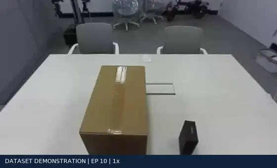
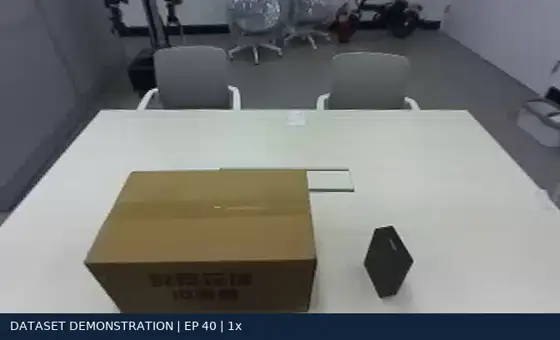
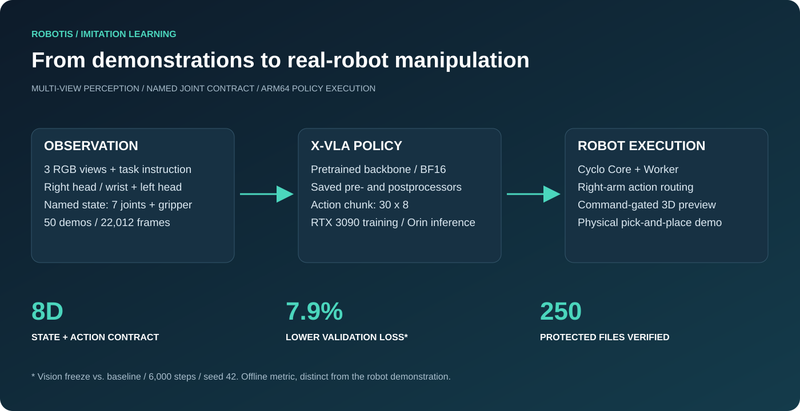
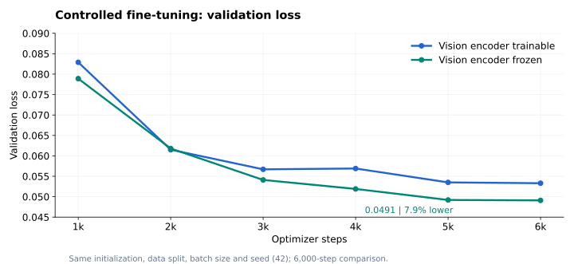

# ROBOTIS-Imitation-Learning

### Vision-Language-Action for Real-World Manipulation

**ROBOTIS AI Worker FFW BG2 Rev4 · X-VLA · LeRobot · Cyclo Intelligence**

[Demonstrations](#dataset-demonstrations) · [Architecture](docs/ARCHITECTURE.md) · [Results](docs/RESULTS.md) · [Configuration](configs/io_contract.json) · [Resources](#resources)

다중 카메라 관측과 자연어 작업 지시를 이용해 **검정 박스를 집어 갈색 박스 위에 적재하는 오른팔 조작 태스크**를 구현했습니다. 시연 데이터 구성, VLA 정책 학습, 관절·카메라 입출력 정합, ARM64 추론 배포를 통합한 엔지니어링 포트폴리오입니다.

## Dataset Demonstrations

실제 BG2 Rev4에서 수집한 작업 시연입니다. 서로 다른 목표 박스 배치에서 **접근 → 파지 → 이송 → 놓기**를 보여줍니다. 아래 영상은 모방학습 데이터셋의 시연이며, 학습된 정책의 자율 실행 영상과 구분됩니다.

| Demonstration A · Episode 10 | Demonstration B · Episode 40 |
|:---:|:---:|
|  |  |
| [MP4 · 15.0 s · Original speed](docs/assets/dataset-demo-ep10.mp4) | [MP4 · 12.2 s · Original speed](docs/assets/dataset-demo-ep40.mp4) |

오른쪽 헤드 카메라의 전체 시퀀스를 원래 속도로 제공합니다. 미리보기는 10fps 애니메이션이며 MP4는 원본과 동일한 30fps입니다. 원본 프레임은 유지하고 영상 아래에 설명 띠를 추가했습니다. [영상 출처 및 구성](docs/DATASET_DEMONSTRATIONS.md)

## Highlights

- **Real-robot integration** — 오른팔 X-VLA 정책을 Cyclo에 통합하고 실제 집기·적재 동작 확인.
- **Named 8D control contract** — 오른팔 7개 관절과 그리퍼의 State·Action을 이름 기준으로 구성하고 원본 19D 값과 전 프레임 일치 검증.
- **Multi-view perception** — 오른쪽 헤드·오른쪽 손목·왼쪽 헤드를 학습·배포의 동일 카메라 슬롯에 연결.
- **Cross-platform deployment** — RTX 3090 학습 환경과 ARM64 Orin 추론 환경에서 가중치·전후처리기 및 `30 × 8` 액션 출력 검증.
- **Controlled fine-tuning** — vision encoder freeze 조건에서 검증 loss **7.9% 감소**, 측정 학습 시간 **29.3% 감소**.

## Architecture

  

세 카메라 영상, 자연어 지시, 오른팔 8D 상태를 X-VLA에 입력합니다. 저장된 전·후처리 통계로 처리한 액션 청크를 오른팔 관절에 대응시키며, 3D 미리보기와 실기체 명령 경로를 구분합니다.

| Interface | Configuration |
|---|---|
| Robot | FFW BG2 Rev4 |
| State / Action | 8D · `arm_r_joint1`–`arm_r_joint7`, `gripper_r_joint1` |
| Image slots | `image`: right head · `image2`: right wrist · `image3`: left head |
| Task instruction | `pick the small black box and stack it on the big brown box` |
| Action chunk | 30 timesteps × 8 joint targets |
| Runtime | ROS 2 Jazzy · Zenoh · Docker · CUDA / BF16 |

[System architecture](docs/ARCHITECTURE.md) · [I/O contract](configs/io_contract.json)

## Training & Results

**50 demonstrations · 22,012 frames · 30 FPS.** 비교 실험은 동일한 `lerobot/xvla-base`에서 각각 시작했습니다. 40개 학습 시연과 10개 검증 시연, batch 8, LR `1e-4`, seed 42, 6,000 step을 공통으로 유지했습니다.

  

| 6,000-step comparison | Vision encoder trainable | Vision encoder frozen |
|---|---:|---:|
| Validation loss | 0.0533 | **0.0491** |
| Trainable parameters | 879,482,456 | **518,850,136** |
| Measured training duration | 79.6 min | **56.2 min** |

저장된 설정을 대조하여 학습 변수 차이가 `freeze_vision_encoder` 하나임을 확인했습니다. 위 수치는 동일 검증 집합을 사용하는 seed 42의 오프라인 학습 비교입니다. 실기체 집기·적재 확인은 별도로 배포한 **8,000 step 정책**에 해당합니다.

[Detailed results](docs/RESULTS.md) · [Measured metrics](results/metrics.json) · [Training configuration](configs/experiment_summary.json)

## Engineering Scope

본 프로젝트는 **데이터·관절·카메라 정합, 모델별 설정, x86_64 / ARM64 시스템 통합, 통제 실험 및 결과 검증**을 수행했습니다. 공식 학습·추론 엔진을 활용하며, 실험 전후 250개 보호 파일의 SHA256 일치와 공식 소스 무변경을 확인했습니다.

이 저장소에는 결과 문서, 시스템 도식, 선별한 시연 영상과 측정값을 공개합니다. 전체 데이터셋과 모델 가중치는 별도로 관리합니다. `configs/`는 문서용 구성 명세입니다.

## Resources

- **Platform:** [ROBOTIS AI Worker](https://github.com/ROBOTIS-GIT/ai_worker)
- **Deployment:** [Cyclo Intelligence](https://github.com/ROBOTIS-GIT/cyclo_intelligence/tree/4fa05374d61666c440ad0b646241e69ea5ce0fdb)
- **Training:** [ROBOTIS LeRobot](https://github.com/ROBOTIS-GIT/lerobot-cyclo/tree/83405ab5059297d34faff105bd95690c75953a1a)
- **Model:** [LeRobot X-VLA documentation](https://huggingface.co/docs/lerobot/xvla)
- **Guide:** [ROBOTIS model inference](https://docs.robotis.com/docs/systems/aiworker/imitation_learning/model_inference/)
- **Attribution:** [Third-party notices](THIRD_PARTY_NOTICES.md)

김동규 · 국립창원대학교 IISL 연구실  
본 저장소는 개인 엔지니어링 포트폴리오이며 ROBOTIS 공식 저장소와 구분됩니다.
