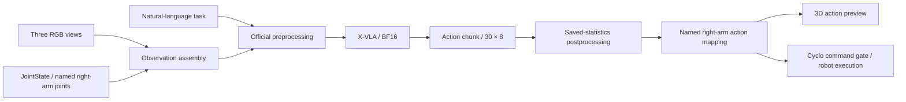

# ROBOTIS-Imitation-Learning

### Vision-Language-Action 기반 실기체 조작 시스템

**ROBOTIS AI Worker FFW BG2 Rev4 · X-VLA · LeRobot · Cyclo Intelligence · ROS 2 / Zenoh**

다중 카메라 영상, 자연어 작업 지시, 관절 상태를 결합해 **검정 박스를 집어 갈색 박스 위에 적재하는 오른팔 조작 태스크**를 구현한 로봇 모방학습 프로젝트입니다. 시연 데이터 정합성 검증, VLA 정책 학습, 이름 기반 관절 매핑, ARM64 추론 배포를 연결하고 실기체에서 집기·적재 동작을 확인했습니다.

이 저장소는 김동규의 엔지니어링 포트폴리오로, 시스템 설계와 검증된 결과를 정리합니다.


[핵심 성과](#engineering-highlights) · [시스템 설계](docs/ARCHITECTURE.md) · [정량 결과](docs/RESULTS.md) · [기술 기반](#technical-foundation)

## Engineering highlights

| 영역 | 구현 및 검증 결과 |
|---|---|
| **Real-robot manipulation** | 오른팔 X-VLA 정책을 Cyclo Intelligence에 통합하고 실기체 집기·적재 동작 확인 |
| **Embodiment alignment** | 19D 원본에서 오른팔 7개 관절 + 그리퍼의 8D State·Action을 구성하고 전 프레임 값 일치 검증 |
| **Multi-camera integration** | 오른쪽 헤드·오른쪽 손목·왼쪽 헤드의 관측을 학습 시 정의한 카메라 슬롯과 정합 |
| **Cross-platform inference** | x86_64 RTX 3090 학습 환경과 ARM64 Orin 추론 환경에서 가중치·전후처리기 로딩 및 예측 실행 검증 |
| **Controlled fine-tuning** | 단일 변수 vision encoder freeze 실험에서 검증 loss **0.0533 → 0.0491**, 상대 **7.9% 감소** |
| **Traceable validation** | 원본 데이터·기존 가중치·기준선 결과 등 **250개 보호 파일의 SHA256 전후 일치** 및 공식 소스 무변경 확인 |

실기체 동작 확인은 배포된 **8,000 step 정책**에 대한 결과이며, loss 개선은 별도로 학습한 **6,000 step 모델 쌍**의 동일 검증 집합 비교입니다.

## System design



**입출력 계약을 명시적으로 관리했습니다.** State·Action은 관절 이름으로 정렬하고, 영상은 학습 시의 `rename_map`과 배포 시 카메라 키를 일치시켰습니다. 학습·추론에서 동일한 전처리·정규화 통계를 사용하며, 예측 액션은 오른팔 명령 대상으로 연결합니다.

| 정책 입력·출력 | 구성 |
|---|---|
| `observation.state` | `arm_r_joint1`–`arm_r_joint7`, `gripper_r_joint1` · 8D |
| `observation.images.image` | 오른쪽 헤드 카메라 |
| `observation.images.image2` | 오른쪽 손목 카메라 |
| `observation.images.image3` | 왼쪽 헤드 카메라 |
| Language instruction | `pick the small black box and stack it on the big brown box` |
| Action chunk | 30 timesteps × 8 joint targets |

구성 명세는 [I/O contract](configs/io_contract.json), 책임 분리는 [Architecture](docs/ARCHITECTURE.md)에 정리했습니다.

## Dataset & training

**50개 시연 · 22,012프레임 · 30 FPS**의 작업 데이터를 사용했습니다. 원본 19D 관절 데이터에서 오른팔에 대응하는 8개 채널을 구성하고, 원본과 추출 결과의 State·Action이 전체 프레임에서 정확히 일치함을 확인했습니다.

비교 학습은 동일한 사전학습 `lerobot/xvla-base`에서 각각 시작하며, 공식 LeRobot 학습 코드와 분할 기능을 사용했습니다.

| 공통 학습 조건 | 값 |
|---|---|
| Backbone | X-VLA · 약 0.88B parameters |
| Training / validation | 40 / 10 episodes · 18,267 / 3,745 frames |
| Optimization budget | 6,000 optimizer steps |
| Batch size / seed | 8 / 42 |
| Learning rate | `1e-4` |
| Precision | BF16 |
| Image augmentation | OFF |
| Compared variable | `freeze_vision_encoder=false` vs. `true` |

## Selected results

### Vision encoder freeze

사전학습된 영상 인코더를 고정하고 언어 인코더와 나머지 학습 가능한 파라미터를 업데이트하는 조건을 비교했습니다. 저장된 학습 설정을 대조하여 실험명·출력 경로를 제외한 학습 변수 차이가 `freeze_vision_encoder` 하나임을 확인했습니다.


| 6,000 step 결과 | Encoder 학습 | Vision encoder freeze |
|---|---:|---:|
| Train loss | 0.018 | 0.025 |
| Validation loss | 0.0533 | **0.0491** |
| 학습 가능 파라미터 | 879,482,456 | **518,850,136** |
| 측정 학습 시간 | 79.6분 | **56.2분** |

동일 GPU 환경의 저장 로그에서 학습 시간은 약 **29.3% 감소**했습니다. 검증 loss는 동일한 10개 시연을 대상으로 계산한 seed 42 실험값이며, 실기체 성공률과 구분되는 오프라인 학습 지표입니다. Train loss는 직전 25 update의 평균입니다.

### Runtime verification

| 검증 항목 | 관측 결과 |
|---|---|
| ARM64 policy loading | Orin에서 X-VLA 가중치·전후처리기 GPU 로딩 완료 |
| Recorded-sample inference | 단일 기록 입력에서 **30 × 8 finite action chunk** 생성 |
| Action routing | 예측한 30개 액션 모두 오른팔 대상으로 구성됨을 비구동 검증 |
| Preview stream | 25초 측정에서 **2,500개 / 약 100Hz**, 50ms 초과 수신 공백 0회 |
| Sensor streams | 같은 구간에서 JointState 약 100Hz, 모델용 카메라 각각 약 30Hz |
| Hardware demonstration | 배포 정책으로 검정 박스 집기 및 갈색 박스 위 놓기 확인 |

Preview 주기는 구독자가 관측한 메시지 도착 주기입니다. 모델 forward 처리율과 물리 제어 주기를 대신하는 수치가 아닙니다. 상세 측정 정의와 수치는 [Results](docs/RESULTS.md), [metrics.json](results/metrics.json)에서 확인할 수 있습니다.

## Engineering contribution

- **데이터 계약 설계:** 관절 이름, 카메라 슬롯, 입력·출력 차원, 저장 통계를 연결하는 모델별 I/O 명세 구성.
- **모델·런타임 통합:** 공식 X-VLA와 Cyclo Core·Worker를 연결하고, x86_64 학습 결과를 ARM64 GPU 추론 환경에서 검증.
- **실험 설계 및 분석:** 학습 조건을 통제한 encoder freeze 비교, 동일 step 지표 분석, 학습 가능 파라미터 확인.
- **실기체 검증:** 명령 차단 상태의 예측 확인과 실제 로봇 실행을 구분하여 집기·적재 태스크 동작 확인.
- **재현성 관리:** 소스 커밋 고정, 저장 설정 비교, 체크포인트 식별, SHA256 기반 데이터·가중치 무결성 검증.

X-VLA 모델 구조, LeRobot 학습 엔진, Cyclo 런타임은 해당 오픈소스 프로젝트를 활용했습니다. 본 프로젝트의 기여는 작업별 데이터 구성·설정, 시스템 통합, 실험 설계 및 결과 검증입니다.

## Repository contents

```text
README.md                       Project overview and selected results
docs/ARCHITECTURE.md             Observation / policy / execution design
docs/RESULTS.md                  Measurement definitions and evidence scope
docs/assets/                    Architecture diagram and validation curve
configs/io_contract.json        Right-arm and camera interface specification
configs/experiment_summary.json Compared training configuration summary
results/metrics.json            Selected measured metrics
results/validation_curve.json   Same-step validation loss measurements
THIRD_PARTY_NOTICES.md           Upstream attribution
```

본 저장소는 결과·설계 문서와 선별한 측정값을 공개합니다. 원본 시연 데이터, 학습 가중치 및 로봇 실행 환경은 별도로 관리합니다. `configs/`는 문서용 설정 요약이며 로봇을 기동하는 실행 스크립트가 아닙니다.

## Technical foundation

- [ROBOTIS AI Worker](https://github.com/ROBOTIS-GIT/ai_worker) — robot platform and bringup.
- [Cyclo Intelligence · pinned revision](https://github.com/ROBOTIS-GIT/cyclo_intelligence/tree/4fa05374d61666c440ad0b646241e69ea5ce0fdb) — deployment and policy runtime.
- [ROBOTIS LeRobot · pinned revision](https://github.com/ROBOTIS-GIT/lerobot-cyclo/tree/83405ab5059297d34faff105bd95690c75953a1a) — official training and inference implementation used in the controlled experiments.
- [LeRobot X-VLA](https://huggingface.co/docs/lerobot/xvla) — model documentation.
- [ROBOTIS model inference guide](https://docs.robotis.com/docs/systems/aiworker/imitation_learning/model_inference/) — platform inference guide.

**Author:** 김동규 · 국립창원대학교 IISL 연구실  
**Stack:** Python · PyTorch · LeRobot · X-VLA · ROS 2 Jazzy · Zenoh · Docker · CUDA
